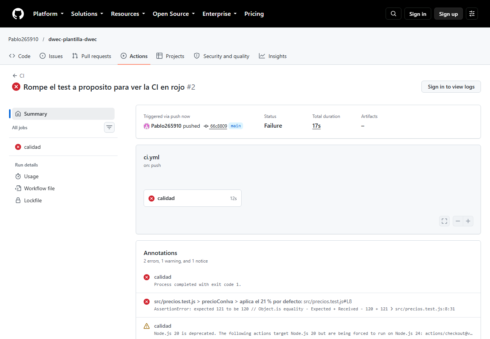
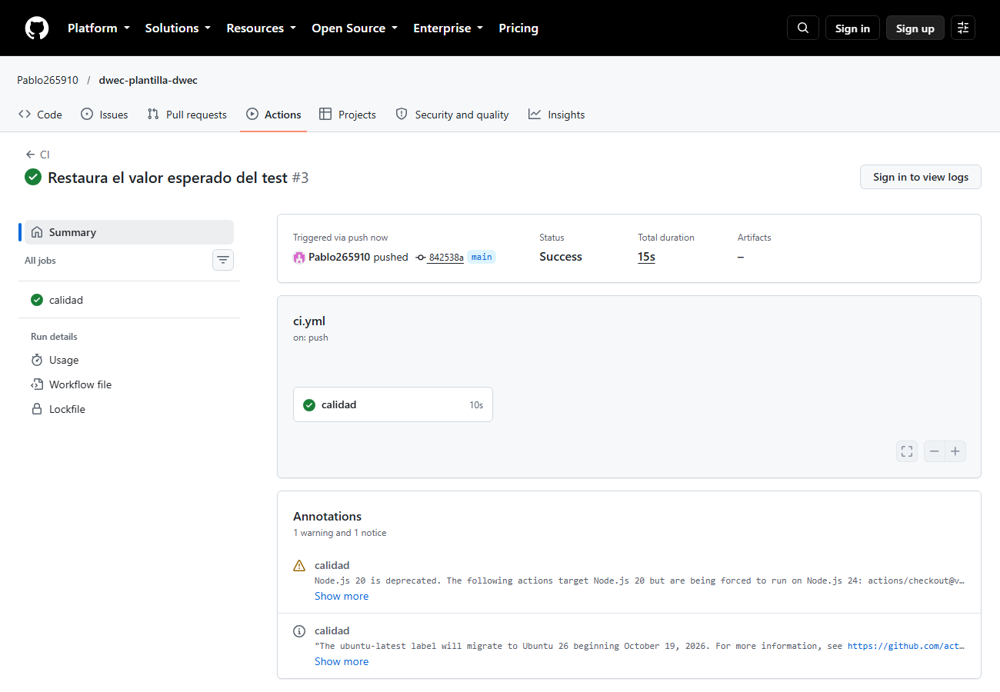

# Plantilla DWEC

Proyecto base para las prácticas del curso: una calculadora de precios con IVA y descuento montada sobre un entorno reproducible (Dev Container), con Vite, Vitest, ESLint, Prettier e integración continua en GitHub Actions. El código de la aplicación ya venía dado; el trabajo de esta práctica es montar y ejecutar las herramientas que lo rodean.

Repositorio: <https://github.com/Pablo265910/dwec-plantilla-dwec>

## Requisitos

- Docker Desktop y VS Code con la extensión **Dev Containers** (opción recomendada: todo se ejecuta dentro del contenedor).
- Alternativa sin contenedor: Node.js 24 y npm instalados en el equipo.
- Git.

## Instalación y ejecución

1. Clona el repositorio y abre la carpeta en VS Code:

   ```bash
   git clone https://github.com/Pablo265910/dwec-plantilla-dwec.git
   cd dwec-plantilla-dwec
   ```

2. Abre la paleta de comandos y elige **Dev Containers: Reopen in Container**. La imagen es `mcr.microsoft.com/devcontainers/javascript-node:24` y el contenedor ejecuta `npm install` automáticamente al crearse (`postCreateCommand`).

3. En la terminal del contenedor (o en la del equipo si usas Node local), arranca el servidor de desarrollo:

   ```bash
   npm run dev
   ```

4. Abre <http://localhost:5173>. Con precio `100`, IVA del 21 % y descuento `10` la página muestra **Precio final: 108,90 €**. Si el descuento queda fuera del rango permitido, la lógica muestra **❌ El descuento debe estar entre 0 y 100**.

Para una instalación reproducible a partir del `package-lock.json` se puede usar `npm ci` en lugar de `npm install`.

## Scripts

| Script | Orden | Qué hace |
|--------|-------|----------|
| `dev` | `npm run dev` | Arranca el servidor de desarrollo de Vite con recarga en caliente en el puerto 5173. |
| `build` | `npm run build` | Compila la aplicación para producción y genera la carpeta `dist/`. |
| `preview` | `npm run preview` | Sirve localmente el resultado de `dist/` para comprobarlo antes de publicarlo. |
| `test` | `npm run test` | Ejecuta Vitest en modo vigilancia sobre los tests del proyecto. |
| `lint` | `npm run lint` | Analiza el código con ESLint y muestra los errores de estilo y de reglas. |
| `format` | `npm run format` | Reescribe los ficheros con el formato de Prettier. |

## Estructura

```text
E09-PlantillaDWEC/
├── .devcontainer/
│   └── devcontainer.json   Configuración del contenedor de desarrollo
├── .github/
│   └── workflows/
│       └── ci.yml          Integración continua en GitHub Actions
├── img/
│   ├── ci.png              Captura de la última ejecución en verde
│   └── ci-rojo.png         Captura de la ejecución fallida a propósito
├── src/
│   ├── main.js             Comportamiento: formulario, eventos y resultado
│   ├── precios.js          Lógica: precioConIva y aplicarDescuento
│   ├── precios.test.js     Once tests de precios.js con Vitest
│   └── style.css           Estilos de la página
├── .gitignore              Excluye node_modules/, dist/ y coverage/
├── .prettierignore         Ficheros que Prettier no revisa
├── .prettierrc             Configuración de Prettier
├── eslint.config.js        Configuración de ESLint
├── index.html              Formulario y resultado
├── package.json            Dependencias y scripts
├── package-lock.json       Versiones exactas de las dependencias
├── ENUNCIADO.md            Enunciado de la práctica
└── README.md               Esta documentación
```

## Arquitectura

**1. Modelo de aplicación.** Todo el código se ejecuta en el navegador del cliente: el HTML, el CSS y el JavaScript se descargan y se ejecutan en el equipo del usuario. El servidor solo entrega ficheros estáticos (la carpeta `dist/`), no ejecuta lógica de negocio ni guarda datos. La calculadora no envía nada al servidor: el evento `submit` se cancela con `evento.preventDefault()` y el resultado se escribe en la propia página. Por tanto, lo que se sube al servidor es únicamente el contenido estático generado por Vite.

**2. Carga de scripts.** `index.html` carga `/src/main.js` con `<script type="module">`, de modo que el navegador lo trata como un módulo ES y respeta los `import` de `precios.js` y `style.css`. En desarrollo, Vite sirve cada módulo por separado y aplica recarga en caliente. En producción, `npm run build` transforma y empaqueta todo: genera `dist/index.html`, un único JavaScript en `dist/assets/index-aDXYxtym.js` (1,40 kB) y un CSS en `dist/assets/index-BxHOtSx5.css` (0,30 kB). Vite resuelve los imports, minifica el código, sustituye `import.meta.env.DEV` por su valor de producción (por eso la página muestra «Versión de producción») y añade un hash al nombre de cada recurso para invalidar la caché cuando cambia.

**3. Separación de capas.** `index.html` contiene la estructura y los campos del formulario, sin lógica. `src/style.css` contiene la presentación. `src/precios.js` es la capa de lógica: funciones puras de cálculo y validación, documentadas con JSDoc, que no tocan el DOM. `src/main.js` es la capa de control: escucha el evento del formulario, lee los valores, llama a las funciones de `precios.js` y escribe el resultado o el error en la página. `src/precios.test.js` comprueba la lógica de forma aislada. Fuera del código de la aplicación quedan las herramientas: `eslint.config.js`, `.prettierrc`, `.devcontainer/devcontainer.json` y `.github/workflows/ci.yml`.

## Calidad

Salida de `npm run lint` (sin errores):

```text
> plantilla-dwec@1.0.0 lint
> eslint .
```

Salida de `npx prettier --check .`:

```text
Checking formatting...
All matched files use Prettier code style!
```

Salida de `npx vitest run`:

```text
 RUN  v5.0.5 C:/Users/pagutor2510/Documents/Desarrollo web en entorno cliente/UD1_2DAW_DWEC_2627/practicas/ejercicios/E09-PlantillaDWEC

 Test Files  1 passed (1)
      Tests  11 passed (11)
   Start at  15:54:52
   Duration  121ms (import 41%, transform 25%, tests 17%, worker 16%, environment 1%)
```

Salida de `npm run build`:

```text
> plantilla-dwec@1.0.0 build
> vite build

vite v8.3.5 building client environment for production...
transforming...
✓ 6 modules transformed.
rendering chunks...
computing gzip size...
dist/index.html                 1.17 kB │ gzip: 0.57 kB
dist/assets/index-BxHOtSx5.css  0.30 kB │ gzip: 0.22 kB
dist/assets/index-aDXYxtym.js   1.40 kB │ gzip: 0.75 kB

✓ built in 49ms
```

## Pruebas

**Test 1: «aplica el 21 % por defecto»** (grupo `precioConIva`). Llama a `precioConIva(100)` sin indicar el tipo de IVA, así que se usa el valor por defecto `0.21`. Espera que el resultado sea exactamente `121` (`expect(...).toBe(121)`): 100 más el 21 % de IVA.

**Test 2: «lanza un error si el descuento es mayor que 100»** (grupo `aplicarDescuento`). Llama a `aplicarDescuento(100, 150)` dentro de una función y usa `toThrow('entre 0 y 100')`: comprueba que la función lanza una excepción y que su mensaje contiene «entre 0 y 100». Con un 150 % de descuento el precio quedaría negativo, por lo que `precios.js` lo rechaza antes de calcular.

**¿Y si se dejara de redondear?** `redondear()` es la función que limita el resultado a dos decimales (`Math.round(importe * 100) / 100`). Si se quitara, fallarían tres tests:

- `precioConIva > aplica el IVA indicado`: `100 * 1.1` da `110.00000000000001` en coma flotante, y el test espera `110`.
- `precioConIva > redondea a dos decimales`: `9.99 * 1.21` da `12.0879`, y el test espera `12.09`.
- `aplicarDescuento > redondea a dos decimales`: `19.99 * 0.85` da `16.9915`, y el test espera `16.99`.

Los otros ocho tests seguirían pasando, porque sus operaciones dan resultados exactos o porque comprueban los errores con `toThrow`. Lo comprobé quitando temporalmente el redondeo: Vitest mostró `3 failed | 8 passed (11)` y después restauré el código.

## Integración continua

El workflow `.github/workflows/ci.yml` se ejecuta en cada `push` a `main`. El job `calidad` corre en `ubuntu-latest` y ejecuta, en este orden: descarga del repositorio (`actions/checkout`), preparación de Node.js 24 con caché de npm (`actions/setup-node`), instalación reproducible (`npm ci`), ESLint (`npm run lint`), comprobación de formato (`npx prettier --check .`), los tests (`npx vitest run`) y la compilación (`npm run build`). Si cualquier paso devuelve un código de error, se detienen los siguientes y la ejecución queda en rojo.

**Ejecución en rojo.** En el commit `66c8809` cambié a propósito el primer test de `toBe(121)` a `toBe(120)`. Los pasos de instalación, lint, formato y tests arrancaron correctamente, pero falló el paso **Ejecutar los tests** con `Process completed with exit code 1`. Vitest señaló `src/precios.test.js > precioConIva > aplica el 21 % por defecto` con `AssertionError: expected 121 to be 120`. El valor esperado del test era incorrecto: la función `precioConIva(100)` devolvía `121`, que es el resultado correcto. Como el paso de tests falló, el de compilación ya no se ejecutó.



**Ejecución en verde.** En el commit `842538a` volví a poner `toBe(121)`. La última ejecución terminó en **Success** (15 s) y los once tests pasaron.


